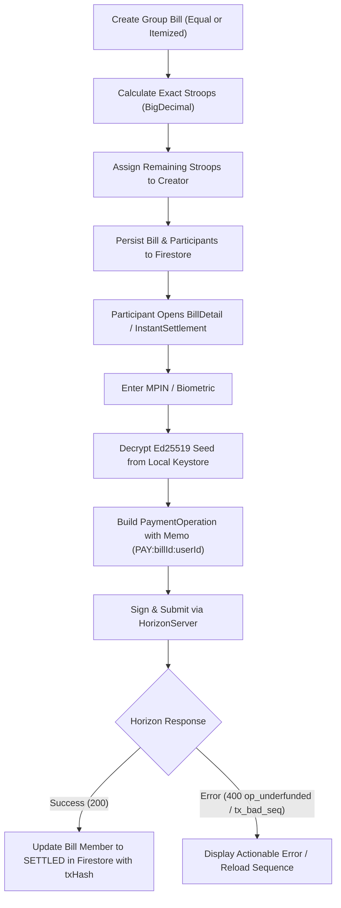

# Technical Discovery & Gap Analysis: PUNDAR Pay Stellar Integration

**Document Version:** 1.0  
**Project:** PUNDAR (Progressive Unified Network for Digital Asset Resilience)  
**Target Module:** PUNDAR Pay (Shared Payments on Stellar Testnet)  
**SDK Evaluated:** Soneso Kotlin Multiplatform Stellar SDK (`com.soneso.stellar:stellar-sdk:1.16.0`)  

---

## 1. Repo Snapshot

### Project Structure & Build Configuration
- **Repository Root Path:** `c:\Users\LOQ\StudioProjects\Pundar-stellar`
- **Build System:** Gradle 8.13 via Gradle Wrapper (`gradle/wrapper/gradle-wrapper.properties`), Gradle Kotlin DSL (`build.gradle.kts`, `settings.gradle.kts`, `app/build.gradle.kts`).
- **Dependency Management:** Centralized Gradle Version Catalog (`gradle/libs.versions.toml`).
- **Modules in Repository:**
  - `:app` — Android Application module (`app/build.gradle.kts`).
  - `circle_contract/` — Standalone Rust / Cargo crate for Soroban smart contracts (`soroban-sdk = "22.0.11"`).
- **Core Build Versions:**
  - Android Gradle Plugin (AGP): `8.12.0`
  - Kotlin Version: `2.0.21` (Plugins: `com.android.application`, `org.jetbrains.kotlin.android`, `org.jetbrains.kotlin.plugin.compose`, `org.jetbrains.kotlin.plugin.serialization`, `com.google.gms.google-services`)
  - Target Platform: **Android Only** (`namespace = "com.example.pundarapp"`, `applicationId = "com.example.pundarapp"`, `minSdk = 26`, `targetSdk = 35`, `compileSdk = 36`). *Note: No iOS, Desktop, or Web targets are declared in Gradle. The project is structured as a standard single-module Android app.*
  - JVM Target: `JavaVersion.VERSION_11` (`jvmTarget = "11"` in `app/build.gradle.kts`).

### Architecture & Patterns
- **UI Layer:** 100% Jetpack Compose with Material 3 (`composeBom = "2024.09.00"`), custom theme system (`ui/theme/Theme.kt`, `Color.kt`, `Type.kt`), and custom components (`ui/components/`).
- **Navigation:** `androidx.navigation.compose` (version `2.8.5`) configured in `ui/navigation/PundarNavigation.kt` with string route definitions (`Routes.kt`).
- **State Management:** Central in-memory Compose Snapshot State singleton in `ui/data/AppState.kt` (`mutableStateListOf`, `mutableStateOf`, `mutableDoubleStateOf`). Screens observe and recompose directly.
- **Dependency Injection:** None (no Dagger, Hilt, or Koin). Singletons are defined as Kotlin `object`s (`AppState`, `AuthRepository`, `PayRepository`, `TransactionRepository`, `StellarWalletManager`, `QrPaymentRepository`).
- **Networking & Backend:**
  - Firebase Firestore (`com.google.firebase:firebase-firestore:33.8.0`) for user profiles, notifications, and simulated transactions.
  - Raw `java.net.URL` in `StellarWalletManager.fundTestnetAccount`.
  - Ktor Client 3.0.1 declared in Version Catalog (`ktor-client-core`, `ktor-client-android`).
- **Local Storage:** Android `SharedPreferences` (`"pundar_prefs"` and `"auth_prefs"`).
- **Serialization:** `kotlinx.serialization` (`kotlinx-serialization-json = "1.6.3"`).
- **Coroutines:** Structured concurrency using `CoroutineScope(Dispatchers.IO + CoroutineExceptionHandler)` inside `AppState`, `rememberCoroutineScope` in composables, and `withContext(Dispatchers.IO)` in repositories.
- **Hardware Integrations:** CameraX (`1.3.1`) + Google ML Kit Barcode Scanning (`17.2.0`) for QR reading; ZXing Core (`3.5.3`) for QR generation.
- **Secrets & Configuration:** `stellar.pepper` in `gradle.properties` injected via `buildConfigField("String", "STELLAR_PEPPER", ...)` in `app/build.gradle.kts`. `local.properties` contains Android SDK path. `google-services.json` used by Firebase plugin.
- **Tests & CI:** Only template test files (`ExampleUnitTest.kt` and `ExampleInstrumentedTest.kt`). No CI workflows configured (no `.github/`).

---

## 2. Relevant Existing Code

| Path | Purpose | Reuse or Change |
| :--- | :--- | :--- |
| `app/src/main/java/com/example/pundarapp/data/stellar/StellarWalletManager.kt` | Core Stellar logic currently using Java SDK (`network.lightsail:stellar-sdk:4.0.0`). Contains keypair generation, friendbot funding, AES-GCM encryption, balance querying, Horizon payment, path payment, and Soroban circle calls. | **Change**: Replace Lightsail SDK imports (`org.stellar.sdk.*`) with Soneso KMP SDK (`com.soneso.stellar.sdk.*`). Convert synchronous calls to `suspend` functions (`KeyPair.random()`, `KeyPair.fromSecretSeed()`, `transaction.sign()`). Implement proper Horizon error extraction. |
| `app/src/main/java/com/example/pundarapp/data/remote/AuthRepository.kt` | Handles user registration, MPIN login, session caching in `SharedPreferences`, user search, and Firestore `users` document persistence. | **Change**: **CRITICAL SECURITY FIX**. Currently saves `encryptedStellarSeed` and plaintext `mpin` to Firestore `users` document. Must change to store the encrypted seed **only on-device** using Android Keystore / `EncryptedSharedPreferences`. Delete plaintext `mpin` and seed from remote Firestore. |
| `app/src/main/java/com/example/pundarapp/data/remote/PayRepository.kt` | Persists and fetches `group_bills` from Firestore. | **Change**: Currently drops `members` on write and returns `emptyList()` on read. Must persist participant public keys, assigned share amounts, and per-member settlement statuses (`SETTLED`, `PENDING`). |
| `app/src/main/java/com/example/pundarapp/data/remote/TransactionRepository.kt` | Executes `settleBills` by batch-updating Firestore `group_bills` and `users` balances without any blockchain interaction. | **Change**: Connect to `StellarWalletManager` to build, sign, and submit real Stellar Testnet transactions per settled bill before updating Firestore state with the confirmed transaction hash. |
| `app/src/main/java/com/example/pundarapp/ui/data/AppState.kt` | Central state holder for `bills`, `walletBalance`, exchange rates, and activities. Explicitly marks on-chain balance as unused in line 751 (`refreshWalletBalance`). | **Change**: Connect `settleBill` and `refreshWalletBalance` to real on-chain Horizon calls via `StellarWalletManager`. Track on-chain balance alongside fiat equivalents. |
| `app/src/main/java/com/example/pundarapp/ui/data/SampleData.kt` | Defines `GroupBill`, `BillMember`, `BillStatus`, and sample bills. | **Change**: `GroupBill` and `BillMember` use primitive `Double` for money and lack participant Stellar public keys and transaction hashes. Add `stellarPublicKey`, `txHash`, and `settlementStatus` fields. |
| `app/src/main/java/com/example/pundarapp/ui/screens/pay/NewGroupBillScreen.kt` | UI for creating a shared expense. Calculates split via `total / selectedMembers.size` with `Double`. | **Change**: Replace floating-point division with exact 7-decimal stroop math (`BigDecimal`). Distribute remainder stroops to the creator so total equals sum of parts. Ensure searched members populate valid `stellarPublicKey`s. |
| `app/src/main/java/com/example/pundarapp/ui/screens/pay/BillDetailScreen.kt` | Displays bill details and has "Settle My Share" button. | **Change**: Currently calls `AppState.settleBill(bill.id)` which just deducts local balance. Needs an MPIN/Biometric confirmation prompt, decrypting seed in memory, signing a Stellar transaction to the creator's address with a bill memo, and awaiting Horizon submission. |
| `app/src/main/java/com/example/pundarapp/ui/screens/pay/InstantSettlementScreen.kt` | Multi-bill settlement UI. Currently calls `TransactionRepository.settleBills(...)` (Firestore only). | **Change**: Add MPIN confirmation prompt and execute on-chain payments (or a multi-operation transaction bundling payments to bill creators) on Stellar Testnet. |
| `app/src/main/java/com/example/pundarapp/ui/screens/pay/BillQrScreen.kt` | Generates dynamic QR code for a bill share and polls `BillQrRepository`. | **Reuse**: QR generation logic is solid. Verify that QR payload contains creator's `stellarPublicKey` and bill memo. |
| `app/src/main/java/com/example/pundarapp/data/qr/QrPayload.kt` | Serializable QR payload structure (`TYPE_BILL_PAYMENT`, `walletId`, `amount`, `billRef`). | **Reuse**: Payload already has `walletId` (Stellar public key) and `billRef`. Can be used as-is. |
| `app/src/main/java/com/example/pundarapp/ui/screens/home/SendMoneyScreen.kt` | P2P transfer screen that prompts for 4-digit MPIN and calls `StellarWalletManager.sendPayment`. | **Reuse**: Serves as the reference UI flow for PIN prompt + on-chain signing + home activity logging. |

---

## 3. SDK Findings (Soneso kmp-stellar-sdk)

### Version & Target Compatibility
- **Latest Maven Release:** `com.soneso.stellar:stellar-sdk:1.16.0` (Verified on Maven Central and repository release tags; 1.6.1 is obsolete).
- **Supported Platforms:**
  - JVM (Android API 24+, Server Java 17+, Desktop JVM)
  - iOS (iOS 14.0+, macOS 11.0+)
  - JavaScript (Node.js 14+, modern browsers with WebAssembly)
- **Cryptographic & Storage Implementations:**
  - **JVM/Android:** BouncyCastle (`org.bouncycastle:bcprov-jdk18on:1.78.1`) for Ed25519 signing. `AndroidStorageAdapter` uses `androidx.security:security-crypto:1.1.0` (EncryptedSharedPreferences / Android Keystore).
  - **iOS/macOS:** Native `libsodium` via C interop (`swift-sodium`). `KeychainStorageAdapter` for iOS Keychain.
  - **JavaScript:** `libsodium-wrappers-sumo` (WebAssembly).

### APIs for PUNDAR Pay
- **Key Generation & Derivation:**
  - `suspend fun KeyPair.random(): KeyPair`
  - `suspend fun KeyPair.fromSecretSeed(seed: CharArray): KeyPair` (or `seed: String`)
  - `fun KeyPair.fromAccountId(accountId: String): KeyPair`
  - `keyPair.getAccountId(): String`, `keyPair.getSecretSeed(): CharArray?`
  - *Note: `random()` and `fromSecretSeed()` are coroutine `suspend` functions.*
- **Network:** `Network.TESTNET` (passphrase `"Test SDF Network ; September 2015"`).
- **Testnet Funding:** `FriendBot.fundTestnetAccount(accountId: String): Boolean` (built directly into the SDK; replaces raw URL calls).
- **Horizon Client:**
  - Instance: `val server = HorizonServer("https://horizon-testnet.stellar.org")`
  - Load Account: `val account = server.loadAccount(accountId)` (fetches current sequence number).
  - Balance Query: `val response = server.accounts().account(accountId)` -> `response.balances.forEach { ... }`.
  - Transaction Submission: `val response = server.submitTransaction(transaction.toEnvelopeXdrBase64())`
  - History: `server.payments().forAccount(accountId).order(Order.DESC).limit(20).execute()`
  - Streaming: `server.payments().forAccount(accountId).stream(...)` (returns `SSEStream` for real-time payment notifications).
- **Transaction Building & Signing:**
  - `TransactionBuilder(sourceAccount, Network.TESTNET)`
  - `.setBaseFee(AbstractTransaction.MIN_BASE_FEE)` (100 stroops = 0.00001 XLM)
  - `.addOperation(PaymentOperation(destination = destAccountId, asset = AssetTypeNative, amount = amountString))`
  - `.addMemo(MemoText("PAY:BILL-101"))` (or `MemoId(101UL)`)
  - `.setTimeout(180L)`
  - `.build()`
  - Signing: `transaction.sign(keyPair)` (*`suspend` function*).
  - Serialization: `transaction.toEnvelopeXdrBase64()`.
- **Assets:**
  - Native XLM: `AssetTypeNative`
  - Issued Asset: `AssetTypeCreditAlphaNum4(code, issuer)` or `Asset.createNonNativeAsset(code, issuer)`
- **Submission Error Handling:**
  - Failed submissions throw `com.soneso.stellar.sdk.horizon.exceptions.BadRequestException` (HTTP 400).
  - The `body` property contains Horizon Problem JSON with error result codes (`extras.result_codes`).
  - Transaction codes: `txBAD_SEQ`, `txINSUFFICIENT_BALANCE`, `txNO_ACCOUNT`, `txINSUFFICIENT_FEE`.
  - Operation codes: `opUNDERFUNDED`, `opNO_DESTINATION`, `opNO_TRUST`, `opSRC_NO_TRUST`.
  - Timeouts throw `RequestTimeoutException` or `ConnectionErrorException`.

### Recommended API Surface & Endpoints
- **For Classic Payments:** **Horizon REST API** is recommended:
  - Horizon Testnet: `https://horizon-testnet.stellar.org`
  - Friendbot Testnet: `https://friendbot.stellar.org`
  - Horizon handles sequence tracking, `PaymentOperation`, account balances, payment history, and SSE streaming.
- **For Soroban Smart Contracts (Circle later):** **Soroban RPC**:
  - Soroban Testnet: `https://soroban-testnet.stellar.org:443`
  - Handled via `SorobanServer` or `ContractClient`.

### Smart Accounts / Passkeys (WebAuthn) Evaluation
- The SDK includes `OZSmartAccountKit` utilizing OpenZeppelin smart contracts on Soroban.
- On Android, it utilizes `AndroidWebAuthnProvider` backed by AndroidX Credential Manager.
- **Suitability for PUNDAR Pay:**
  1. WebAuthn credentials in Soroban control smart contract accounts (secp256r1 curve), **not** classic Stellar Ed25519 accounts (`G...`). Classic `PaymentOperation` on Horizon requires Ed25519 signatures.
  2. Android passkeys require API 28+ (Android 9.0) and require hosting a verified Digital Asset Links file (`/.well-known/assetlinks.json`) with the application's SHA-256 cert fingerprint on a public domain.
  3. **Verdict:** For PUNDAR Pay, local Ed25519 key custody (encrypted via Android Keystore / `EncryptedSharedPreferences` and signed locally upon 4-digit MPIN or Biometric entry) is the proper, self-contained architecture. OpenZeppelin passkeys should be reserved for **PUNDAR Circle** (Soroban smart contracts) where contract-level custom accounts are natively evaluated.

### Version Conflicts & Upgrade Requirements
1. **JVM / Java Target:**
   - PUNDAR currently targets Java 11 (`JavaVersion.VERSION_11`, `jvmTarget = "11"` in `app/build.gradle.kts`).
   - Soneso SDK requires Java 17 bytecode (`JavaVersion.VERSION_17`, `jvmTarget = "17"`).
   - **Resolution:** Update `compileOptions` and `kotlinOptions` in `app/build.gradle.kts` to `JavaVersion.VERSION_17` and `jvmTarget = "17"`.
2. **Gradle & AGP Compatibility:**
   - PUNDAR uses Gradle 8.13 and AGP 8.12.0.
   - Soneso SDK builds with Gradle 9.0+ and AGP 8.12.3. Gradle 8.13 can consume `com.soneso.stellar:stellar-sdk:1.16.0` from Maven Central without upgrading Gradle itself, provided Java 17 toolchain is active.
3. **Kotlin Version:**
   - PUNDAR uses Kotlin `2.0.21`.
   - Soneso SDK was compiled with Kotlin `2.2.21`.
   - While Kotlin 2.0 can consume KMP libraries, Kotlin metadata 2.2 may trigger compiler compatibility warnings. If compiler errors occur on metadata parsing, Kotlin in `gradle/libs.versions.toml` should be bumped to `2.1.10` or higher.
4. **Library Clashes:**
   - PUNDAR's `gradle/libs.versions.toml` defines `stellar-sdk = "4.0.0"` from group `network.lightsail`.
   - Change coordinate to: `group = "com.soneso.stellar"`, `name = "stellar-sdk"`, `version = "1.16.0"`.
   - PUNDAR defines `ktor = "3.0.1"`, while Soneso SDK uses `3.3.3`. Bump Ktor to `3.3.3` to prevent runtime classpath conflicts.
   - PUNDAR defines `kotlinxSerialization = "1.6.3"`, while Soneso SDK uses `1.9.0`. Bump to `1.8.0`+.

---

## 4. PUNDAR Pay Integration Plan

### Step 1: SDK Dependency & Build Toolchain Alignment
- **Files to touch:**
  - `gradle/libs.versions.toml`
  - `app/build.gradle.kts`
- **Actions:**
  1. In `libs.versions.toml`, update `stellar-sdk` coordinate from `network.lightsail:stellar-sdk:4.0.0` to `com.soneso.stellar:stellar-sdk:1.16.0`.
  2. Bump `ktor` to `3.3.3` and `kotlinxSerialization` to `1.8.0` (or `1.9.0`).
  3. In `app/build.gradle.kts`, change `compileOptions` and `kotlinOptions` to `JavaVersion.VERSION_17` and `jvmTarget = "17"`.
- **Done-When Check:** `./gradlew :app:assembleDebug` completes without compiler errors or classpath conflicts.

### Step 2: Refactor Stellar Engine to Soneso KMP SDK
- **Files to touch:**
  - `app/src/main/java/com/example/pundarapp/data/stellar/StellarWalletManager.kt`
- **Actions:**
  1. Replace `org.stellar.sdk.*` imports with `com.soneso.stellar.sdk.*` and `com.soneso.stellar.sdk.horizon.*`.
  2. Replace custom HTTP friendbot call with `FriendBot.fundTestnetAccount(publicKey)`.
  3. Rewrite `sendPayment` using `HorizonServer.loadAccount()`, `TransactionBuilder`, `PaymentOperation(dest, AssetTypeNative, amount)`, `MemoText(memo)`, and `transaction.sign(keyPair)`.
  4. Parse `BadRequestException` response body for specific Stellar error codes (`op_underfunded`, `op_no_destination`, `tx_bad_seq`).
- **Done-When Check:** Unit test or sample script funds a new keypair via `FriendBot` and submits a 1 XLM payment between two testnet addresses, returning a valid transaction hash.

### Step 3: Secure Local Keystore (Eliminate Server-Side Custody)
- **Files to touch:**
  - `app/src/main/java/com/example/pundarapp/data/remote/AuthRepository.kt`
  - `app/src/main/java/com/example/pundarapp/data/stellar/StellarWalletManager.kt`
- **Actions:**
  1. Remove `encryptedStellarSeed` and `mpin` fields from the Firestore user document write in `AuthRepository.registerWithPhone`.
  2. Implement an on-device secure keystore using Android `EncryptedSharedPreferences` (or Android Keystore-backed AES cipher) to store the encrypted seed locally on the device.
  3. Hash the MPIN locally (e.g. Argon2 or PBKDF2 with salt) for session unlocks; do NOT upload plaintext MPIN to Firestore.
- **Done-When Check:** Inspect Firestore after registering a new test user: verify that neither `mpin` nor `encryptedStellarSeed` appears in the remote document, and the wallet successfully decrypts locally with the MPIN.

### Step 4: Robust Precision Math & Remainder Rounding
- **Files to touch:**
  - `app/src/main/java/com/example/pundarapp/ui/data/SampleData.kt`
  - `app/src/main/java/com/example/pundarapp/ui/screens/pay/NewGroupBillScreen.kt`
- **Actions:**
  1. Implement split calculation in `NewGroupBillScreen` using `BigDecimal` and integer stroops ($1\text{ XLM} = 10^7\text{ stroops}$):
     $$\text{shareStroops} = \lfloor \text{totalStroops} / N \rfloor$$
     $$\text{remainderStroops} = \text{totalStroops} - (\text{shareStroops} \times N)$$
  2. Assign the `remainderStroops` to the creator's share so that the exact sum of all shares equals the total bill amount down to the stroop.
  3. Format payment amounts as strings with 7 decimal places for `PaymentOperation`.
- **Done-When Check:** Creating a 100 XLM bill with 3 members assigns 33.3333334 XLM to the creator and 33.3333333 XLM to each of the other two members; the sum equals exactly 100.0000000 XLM.

### Step 5: Persist Participant Public Keys & Bill Members
- **Files to touch:**
  - `app/src/main/java/com/example/pundarapp/data/remote/PayRepository.kt`
  - `app/src/main/java/com/example/pundarapp/ui/data/SampleData.kt`
- **Actions:**
  1. Update `BillMember` data class to include `stellarPublicKey: String`, `isSettled: Boolean`, and `settlementTxHash: String?`.
  2. Update `PayRepository.createBill` to serialize the `members` list as a subcollection or nested map array in Firestore `group_bills/{billId}`.
  3. Update `PayRepository.getBills` to deserialize `members` so participants and their wallet addresses are restored across app sessions.
- **Done-When Check:** A created bill retrieved from Firestore retains all members with their public keys, share amounts, and initial pending settlement status.

### Step 6: Connect Bill Settlement to Stellar Testnet Transactions
- **Files to touch:**
  - `app/src/main/java/com/example/pundarapp/ui/screens/pay/BillDetailScreen.kt`
  - `app/src/main/java/com/example/pundarapp/ui/screens/pay/InstantSettlementScreen.kt`
  - `app/src/main/java/com/example/pundarapp/data/remote/TransactionRepository.kt`
- **Actions:**
  1. In `BillDetailScreen`, clicking "Settle My Share" displays an MPIN dialog (`PinInputComponent`).
  2. On PIN submit: decrypt the user's secret seed locally, construct a Stellar transaction to the bill creator's public key for `member.amount` XLM, set memo `MemoText("PAY:$billId")`, sign, and submit to Horizon.
  3. On success: write the `transactionHash` to the member's record in Firestore `group_bills/{billId}`, mark `isSettled = true`, and append a `HomeActivity` record with the transaction link.
  4. In `InstantSettlementScreen`: iterate through selected bills, execute each Stellar payment (or combine multiple `PaymentOperation`s into a single atomic multi-payment transaction), and update statuses upon confirmation.
- **Done-When Check:** Settling a share submits an actual transaction to Stellar Testnet; the transaction hash is verified on Stellar Expert (`https://stellar.expert/explorer/testnet/tx/{hash}`) and the bill UI updates to Settled.

### Step 7: QR Code Payment Settlement Execution
- **Files to touch:**
  - `app/src/main/java/com/example/pundarapp/ui/screens/home/QrSendConfirmScreen.kt`
  - `app/src/main/java/com/example/pundarapp/data/remote/QrPaymentRepository.kt`
- **Actions:**
  1. In `QrSendConfirmScreen`, when paying a `TYPE_BILL_PAYMENT` QR:
  2. Prompt for MPIN, decrypt sender seed, and execute `StellarWalletManager.sendPayment` to the recipient's `walletId` with amount and memo `billRef`.
  3. Only after the Stellar transaction succeeds with a confirmed hash, update `BillQrRepository` status to `PAID` and log the transaction in Firestore.
- **Done-When Check:** Scanning a bill QR from Device B and confirming with MPIN submits a Stellar payment on-chain, and Device A's `BillQrScreen` immediately detects `PAID` status.

### Step 8: Transaction State Verification & Settlement History Reconciliation
- **Files to touch:**
  - `app/src/main/java/com/example/pundarapp/ui/data/AppState.kt`
  - `app/src/main/java/com/example/pundarapp/data/stellar/StellarWalletManager.kt`
- **Actions:**
  1. Replace simulated `refreshWalletBalance()` in `AppState.kt` with an actual call to `StellarWalletManager.getXlmBalance(publicKey)`.
  2. Implement an account payment listener (`server.payments().forAccount(publicKey).stream(...)`) to automatically detect incoming settlement payments and update bill statuses in Firestore in real time.
- **Done-When Check:** The app header displays the real testnet XLM balance fetched from Horizon, and incoming bill settlements are reflected automatically without manual refresh.

---

## 5. Risks and Unknowns

1. **Testnet Account Activation for Unfunded Contacts:**
   - In Stellar, a `PaymentOperation` fails with `op_no_destination` if the recipient account has never been funded with at least 1 XLM (the base account reserve).
   - *Question for User/Product:* When a user adds an unregistered phone number or an unactivated Stellar account to a group bill, should PUNDAR automatically call `FriendBot` to activate the contact's account on Testnet, or should the app use `CreateAccountOperation` (which sends 1+ XLM from the payer to create the account) instead of `PaymentOperation`?
2. **Settlement Architecture — P2P Reimbursement vs Group Escrow:**
   - In PUNDAR Pay, is settlement strictly peer-to-peer (each participant sends XLM directly to the creator's personal Stellar wallet), or should bill funds be paid into a temporary escrow account/contract that only releases when all participants have paid?
   - *Note:* Direct P2P avoids smart contract complexity in Pay and leaves Circle escrows for Soroban later, but requires confirming whether partial bill settlements are acceptable.
3. **Memo Field Truncation & Uniqueness:**
   - Stellar `MemoText` is strictly limited to 28 UTF-8 bytes.
   - PUNDAR bill IDs currently use timestamps like `bill_1712345678901` (18+ bytes). A compound memo like `PAY:bill_1712345678901:userId` will exceed 28 bytes and be rejected by Horizon.
   - *Question for Architecture:* Should we use a compact 64-bit integer ID (`MemoId`) or a truncated 8-character UUID hash (`MemoText` up to 28 chars) to uniquely identify settlements on-chain?
4. **Offline / Out-of-Sync Participant State:**
   - If Participant A settles on-chain via a direct Stellar wallet transaction, but their mobile network drops before the Firestore database is updated, how should the app reconcile?
   - *Recommendation:* Use Horizon's `payments().forAccount()` or account SSE stream on app launch to detect incoming transactions with the bill's memo and automatically mark the bill as settled in Firestore.
5. **Kotlin Multiplatform Timeline & Roadmap:**
   - The current repository is an Android-only project (`com.android.application`), but the goal states a KMP architecture.
   - *Question for Team:* In what milestone will the codebase be restructured into a shared multiplatform module (`:shared` with `commonMain`, `androidMain`, `iosMain`)? Starting with Soneso KMP SDK inside `:app` is clean and fully compatible, and will make moving logic into `commonMain` straightforward when iOS is introduced.

